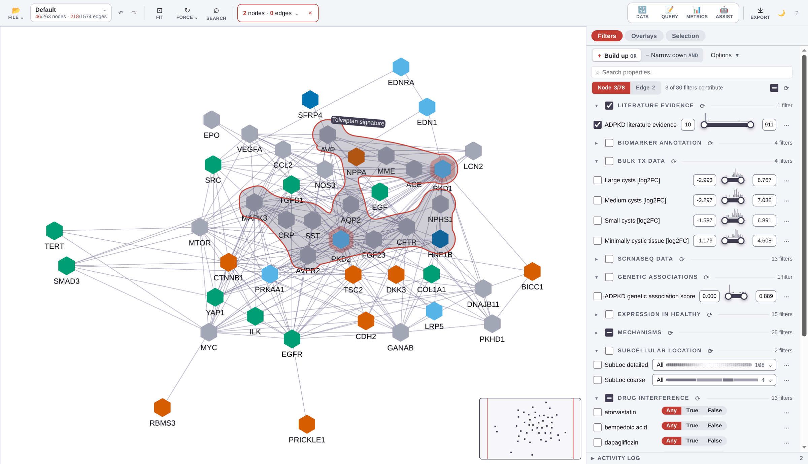
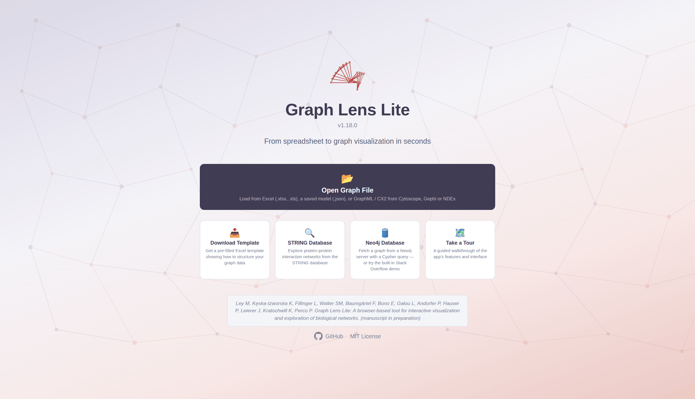
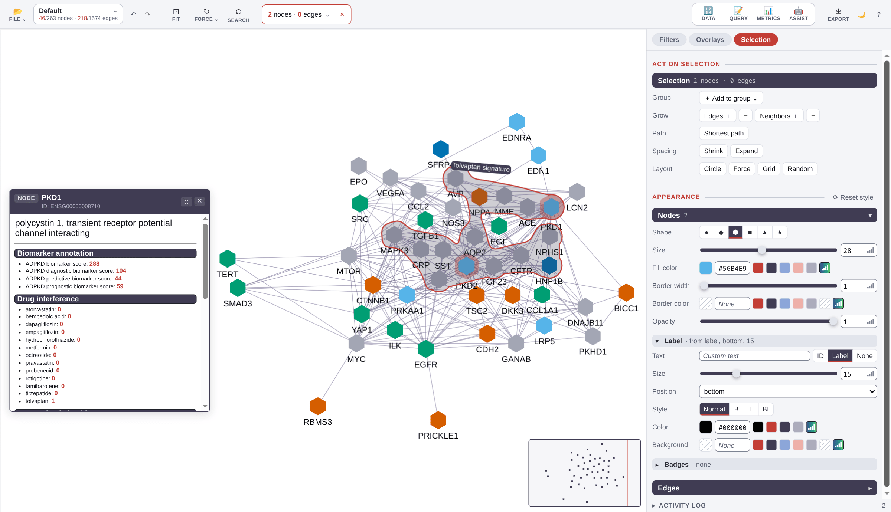
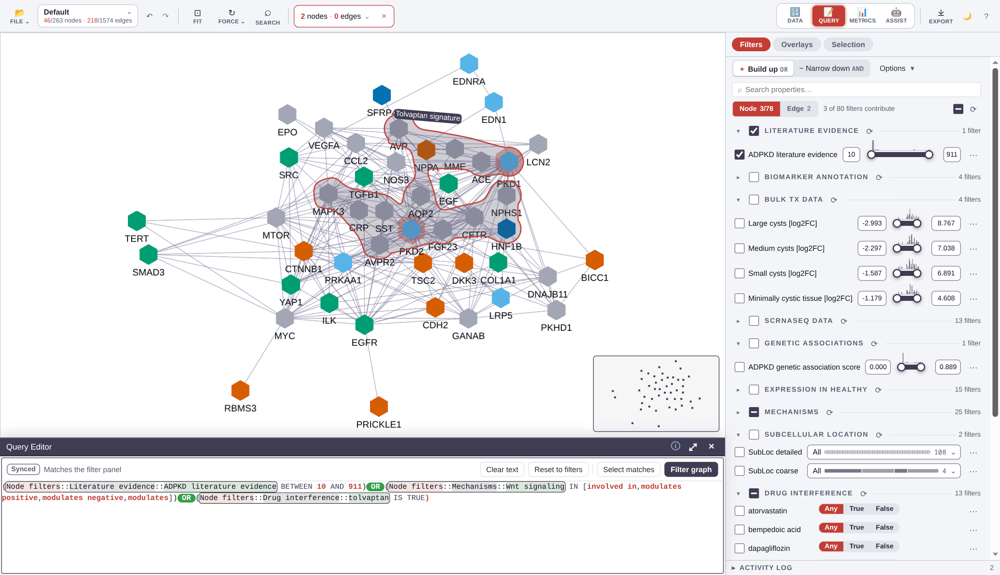
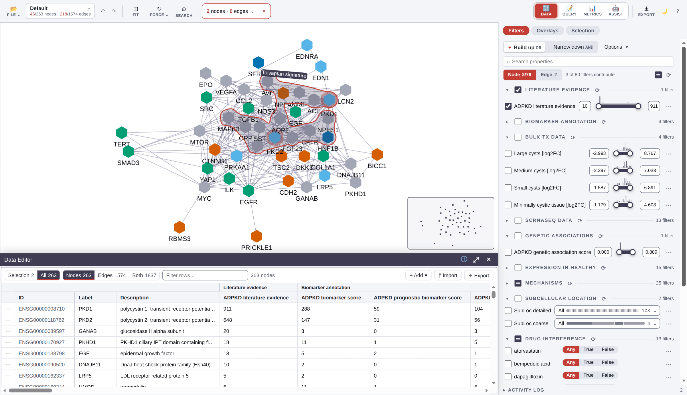
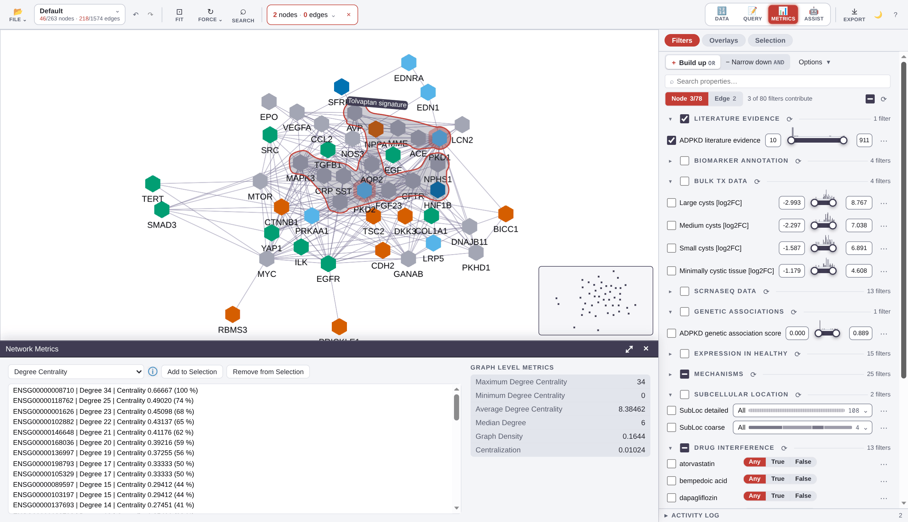
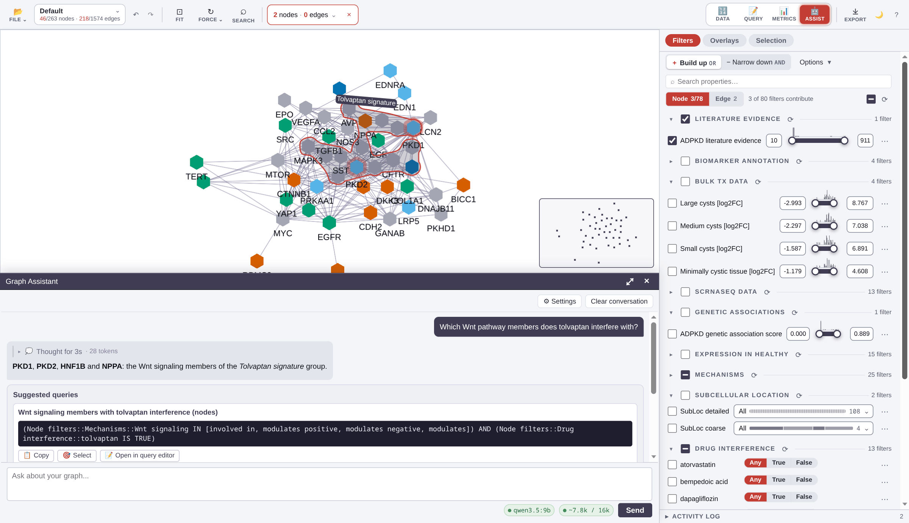

<p align="center">
  
</p>

<h3 align="center">
   Visualise and navigate property graphs in a lightweight interface.<br>
   Works in any modern browser, with native Electron desktops for Windows, macOS, and Linux.
</h3>

<p align="center">
  <a href="https://delta4ai.github.io/GraphLensLite/">Live Demo</a> · <a href="https://github.com/Delta4AI/GraphLensLite/releases/latest">Latest Release</a>
</p>

## Quickstart

Download the [latest release](https://github.com/Delta4AI/GraphLensLite/releases/latest) for your platform:

| Platform | Recommended download | Notes |
|----------|---------------------|-------|
| **Web** | `graph-lens-lite_inline_X.Y.Z.html` | Just open in a browser — no install needed |
| **Windows** | `Graph.Lens.Lite.X.Y.Z.exe` | Portable — run directly, nothing to install |
| **macOS** | `Graph.Lens.Lite-X.Y.Z-<arch>.dmg` | Disk image |
| **Linux** | `Graph.Lens.Lite-X.Y.Z.AppImage` | Portable — `chmod +x` and run |

> Other formats are also available: Windows installer (`.Setup.X.Y.Z.exe`), `.deb`, `.snap`, `.zip`.

Then:
1. (Optional) Download a [template](templates/simple-template.xlsx) and add your data
2. Launch Graph Lens Lite and load a demo or your file

### Container

Run it on any OS with only Docker or Podman installed: the image builds the app from source and serves the viewer together with the [ingest service](SERVICE.md).

```bash
docker build -t graph-lens-lite .
docker run --rm -p 8080:8080 graph-lens-lite    # open http://localhost:8080/
```

With Podman, use `podman build --format docker -t graph-lens-lite .` (the `docker` format keeps the healthcheck) and `podman run` the same way. To push graphs to it, pass `-e GLL_API_TOKEN=<long random string>`; see [SERVICE.md](SERVICE.md#running-in-a-container).

## File formats

| Format | Open | Export | What travels |
|--------|:----:|:------:|--------------|
| Excel (`.xlsx`, `.xls`) | ✓ | ✓ | nodes, edges, properties, styling columns, coordinates ([template](templates/simple-template.xlsx)) |
| JSON model (`.json`) | ✓ | ✓ | everything — workspaces, styles, filters, groups, notes |
| GraphML (`.graphml`) | ✓ | ✓ | nodes, edges, typed attributes, labels, positions, edge direction |
| CX2 (`.cx2`) | ✓ | ✓ | nodes, edges, typed attributes, names, positions |

Save your work with **File › Save as JSON** (or **S**); the JSON model is the only format that keeps everything. Closing the app with unsaved changes asks first.

GraphML and CX2 are for exchange with Cytoscape, Gephi, yEd, NetworkX, igraph and NDEx. Both formats store nodes, edges, attributes and positions. GLL styles, workspaces and groups are not exported, and visual styles in an imported file are skipped with a notice. On import, attributes go to the *Uncategorized Properties* group; an attribute named `score [omics]` goes to group *omics*, as with Excel column headers.

## Features

<p align="center">
  
</p>

Filter by any property with range sliders (each showing its distribution), category lists and true/false switches; build a view up from nothing or narrow the full graph down. Group nodes as bubble sets, style anything by hand or map it from data, and keep independent workspaces, each with its own positions, styles, filters and groups. Export as JSON, PNG, SVG, Excel, GraphML or CX2.

|  |  |  |
|:---:|:---:|:---:|
| Open Excel, JSON, GraphML or CX2 files, fetch a graph from Neo4j, explore a demo or take the tour | Inspect any element's data, act on the selection and edit its appearance: shape, size, colour, label, badges, halo, arrows, edge flow | Write queries with boolean logic, nested conditions and ranges; the editor stays in sync with the filter panel |
|  |  |  |
| Edit nodes, edges and columns in a spreadsheet that stages every change for review before it applies | Rank nodes by degree, betweenness, closeness, eigenvector centrality or PageRank, with graph-level summaries | Ask questions in plain English; a local model (Ollama) answers from the loaded graph and suggests queries |

## Development

```bash
npm install              # install dependencies
npm run bundle:serve     # dev server with watch + sourcemaps
npm run serve            # static http-server on :8000
npm start                # electron app
npm run dist-linux       # Linux build
npm run dist-windows     # Windows build
npm run serve:api        # standalone ingest service (HTTP API + live viewer)
```

See [CONTRIBUTING.md](CONTRIBUTING.md) for the full list of npm scripts, version management, code style, and commit guidelines.

## Send data via the API

Run Graph Lens Lite as a small standalone service so other apps can push graphs to it over HTTP and watch them render live in the browser:

```bash
cp .env.example .env     # set GLL_API_TOKEN
npm run serve:api        # serves the viewer + ingest API (default :7637)
```

```bash
curl -X POST http://127.0.0.1:7637/api/graph \
  -H "Authorization: Bearer $GLL_API_TOKEN" -H "Content-Type: application/json" \
  -d '{"nodes":[{"id":"A"},{"id":"B"}],"edges":[{"source":"A","target":"B"}]}'
```

Open `http://127.0.0.1:7637/` and the pushed graph appears; further pushes update it live.

- **[SERVICE.md](SERVICE.md)** — running, configuring, and deploying the ingest service.
- **[API.md](API.md)** — payload reference for other apps: how to build JSON for meaningful graphs (styling, filterable data, bubble groups, layouts).

## Contributing

Contributions are welcome. Please read [CONTRIBUTING.md](CONTRIBUTING.md) before filing issues or submitting pull requests. See [ARCHITECTURE.md](ARCHITECTURE.md) for a map of the codebase.

## License

MIT — see [LICENSE](LICENSE) for details.

## Known Issues

1. The Query Editor cursor tends to change position on multiline queries

## Disclaimer

- Uses the [STRING](https://string-db.org/) database for demo purposes ([citation](https://doi.org/10.1093/nar/gkac1000))
- No guarantees on the accuracy of the results
- This project includes third-party software — see [THIRD_PARTY_NOTICES](THIRD_PARTY_NOTICES) for details
